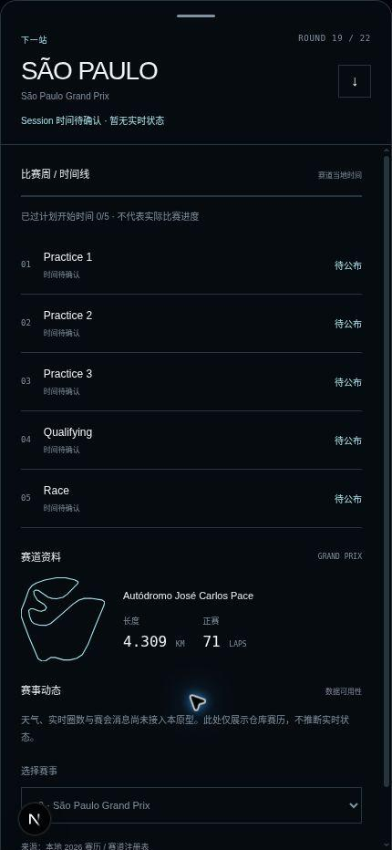

# Atlas Race Week 抽屉手势修复

日期：2026-11-06（Asia/Shanghai）。在原型分支 `work/atlas-2-globe-raceweek-prototype-20261102` 上更新 Draft PR #68。

本报告替代初版审计中关于“三档抽屉”的描述；初版报告保留为历史记录。

## 修改

只保留 `collapsed`、`expanded` 两个状态。收起时显示底部紧凑信息，展开时占满可用视口；移动中允许任意位移，松手后吸附到两个端点之一。距离采用相对于抽屉可移动范围的阈值，释放速度取最近 80ms 的采样，暂停后释放不沿用过期速度。轻微慢拖保留原状态；快速反向释放可改变吸附方向。

指针移动仅更新 ref，在 requestAnimationFrame 中直接写抽屉的 transform 属性（避免每帧修改继承型 CSS 变量）。拖动期间不调用 React setState、不读取布局；获取手势与视口改变时才测量尺寸。最终状态提交与 220ms 吸附过渡分开。拖动条支持点击、Enter/Space、方向键；顶部信息区域支持拖动，内部按钮保留点击行为。

Atlas 原型挂载时锁定 html/body 的滚动与 overscroll，并记录原样式和滚动位置。卸载时恢复。视觉视口的 height、width 和 offset 随 visualViewport resize/scroll 更新；ResizeObserver 同步 CSS 容器与 JS 的手机模式，避免旋转或工具栏变化后宽度判断滞后。安全区域通过 env(safe-area-inset-top/bottom) 处理。

展开后只允许内容区独立滚动；收起后内容区 inert、不可滚动。内容到顶后的下拉不会误关抽屉；收起使用始终可见的拖动条或顶部信息区域。文档级 touchmove 防护只在原型挂载期间存在，在顶部/底部阻断滚动链；内容区中段保留浏览器原生滚动。Canvas 的旋转和缩放仍由原有控制器负责。

没有修改地球渲染器、纹理、赛历、赛事内容、Homepage、Calendar 或生产配置。Canvas 保留原位置、无动态 key，端点变化不卸载 Canvas。手机完全展开时沿用原型已有的渲染暂停逻辑。

## 实际检查

可用浏览器为云端 Chromium；以下手机尺寸为同一组件的 CSS 容器检查，不能冒充真实 iPhone 或 WebKit。

| 检查 | 实际结果与限制 |
| --- | --- |
| 连续上滑、下滑 | 在 390×844 容器中多次指针拖动后均吸附到两个合法终点；工具控制的拖动速度不能等同真人高速触摸 |
| 轻微拖动后释放 | 展开状态下约 13px 慢拖后仍为 expanded；轻微慢拖及反向快速释放的状态算法也有单元测试 |
| 全屏内容纵向滚动 | 390 容器中内容 scrollTop 达到 152px，window/body/root 的 scrollTop 均为 0，保持 expanded |
| 从内容顶部下滑收起 | 内容回到顶部后，经明确的顶部手势区下拉可收起；内容滚动本身不关闭抽屉 |
| 拖动条点击、快速切换 | 430×932 中点击可展开，连续三次点击从展开回到收起；修复了捕获到父元素导致按钮点击丢失的问题 |
| 展开覆盖范围 | 390 展开终点 y=0、高 844；430 展开终点 y=0、高 932 |
| 离开原型后的锁定清理 | 通过 Next Link 返回 /atlas-v2 后，body position、html overflow、html overscroll-behavior 的内联值恢复为空 |
| 地球旋转与抽屉切换 | 未完成实际渲染验收：云端 Chromium 无 WebGL；有真实 Canvas 身份连续性的 E2E 用例，但未执行成功 |
| iPhone Safari 回弹、安全区域和工具栏 | 未验证真机；实现了防护，但不能宣称已通过 Safari 验收 |
| 主观流畅度、帧间隔 | 未给出真机结论，不编造 FPS 或延迟数值 |

自动化检查及日志见 `gesture-qa/`。本机 Playwright Chromium 缺失；本轮尝试安装时下载内容无法解压（End of central directory record signature not found），因此自动化浏览器验收受阻。

生产构建、类型、lint、单元测试与 diff 检查在提交前执行。以本次日志为准，不能将初版通过项套用于本次修改。保持 Draft，等待真实 iPhone Safari 对高速触摸、回弹、Home Indicator、浏览器工具栏及地球连续性的实机复核。

## 提交前质量门

| 命令 | 结果 |
| --- | --- |
| npm run build | 通过 |
| npm run typecheck | 通过 |
| npm run lint | 通过 |
| npm run test:unit | 28/28 通过 |
| git diff --check | 通过 |
| npm run test:e2e -- tests/e2e/atlas-prototype.spec.ts --max-failures=1 | 环境阻塞：首次启动缺少 Chromium 可执行文件，5 个用例未运行；没有将其记为通过 |

测试用例覆盖两种手机尺寸、重复拖动、轻微释放、内部滚动、顶区收起、视口变化、路由锁定清理及真实 Canvas 身份检查。这里的“覆盖”指已编写测试，不表示这些 E2E 已执行通过。
